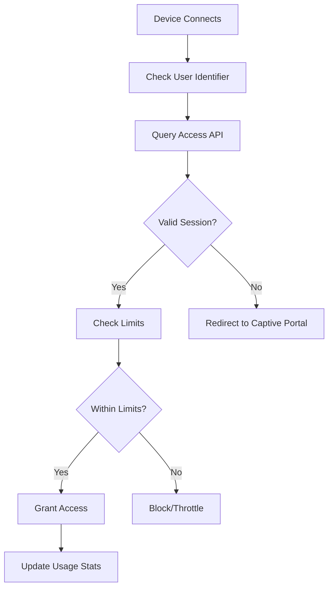

# MeshLink Access Management System

This document explains how the MeshLink access management system works and how to integrate it with your internet gateway services.

## Overview

The access management system creates lightweight session records after successful payments, storing user access permissions, service tiers, and expiration dates. This data can be used by separate gateway services to control internet access.

## Database Schema

### Access Sessions Table
```typescript
interface AccessSession {
  id: number;                    // Auto-increment ID
  sessionGuid: string;           // Unique session identifier
  userIdentifier: string;        // Device MAC, IP, or unique ID
  tierId: string;               // Reference to pricing tier
  tierName: string;             // Human-readable tier name
  paymentMethod: string;        // 'stripe' or 'crypto'
  paymentReference: string;     // Payment ID or transaction hash
  startDate: Date;              // When access began
  expiryDate: Date;             // When access expires
  dataLimitMB: number;          // Total data allowance
  dataUsedMB: number;           // Current data usage
  speedMbps: string;            // Speed limit ('10' or 'max')
  status: string;               // 'active', 'expired', 'suspended'
  nodeOperator: string;         // Node operator identifier
  createdAt: Date;              // Record creation time
  lastAccessAt: Date | null;    // Last internet activity
}
```

## API Endpoints

### Payment Completion
```http
POST /api/complete-payment
Content-Type: application/json

{
  "tierId": "premium",
  "userIdentifier": "device_mac_address_or_id", 
  "paymentMethod": "stripe",
  "paymentReference": "stripe_payment_id"
}
```

**Response:**
```json
{
  "success": true,
  "sessionGuid": "session_1749854000_abc123def",
  "expiryDate": "2025-01-21T10:30:00Z",
  "tierName": "Premium Speed",
  "dataLimitMB": 5120,
  "speedMbps": "100"
}
```

### Check Access Status
```http
GET /api/access/{sessionGuid}
```

**Response:**
```json
{
  "sessionGuid": "session_1749854000_abc123def",
  "tierName": "Premium Speed",
  "status": "active",
  "dataLimitMB": 5120,
  "dataUsedMB": 234,
  "speedMbps": "100",
  "startDate": "2025-01-14T10:30:00Z",
  "expiryDate": "2025-01-21T10:30:00Z",
  "remainingTimeMs": 604800000
}
```

### Get User Sessions
```http
GET /api/access/user/{userIdentifier}
```

### Update Data Usage
```http
PATCH /api/access/{sessionGuid}/usage
Content-Type: application/json

{
  "dataUsedMB": 500
}
```

## Integration with Gateway Services

### 1. Device Identification
Your gateway service should identify devices using:
- MAC address (most reliable)
- DHCP client identifier
- Device fingerprinting
- Captive portal session cookies

### 2. Access Control Flow


### 3. Implementation Examples

#### Python (using requests)
```python
import requests
import time

def check_user_access(user_identifier):
    """Check if user has valid access session"""
    response = requests.get(f'/api/access/user/{user_identifier}')
    
    if response.status_code == 200:
        sessions = response.json()
        active_sessions = [s for s in sessions if s['status'] == 'active']
        
        if active_sessions:
            session = active_sessions[0]  # Use most recent
            
            # Check if session is expired
            expiry = time.strptime(session['expiryDate'], '%Y-%m-%dT%H:%M:%SZ')
            if time.time() < time.mktime(expiry):
                return session
    
    return None

def update_data_usage(session_guid, bytes_used):
    """Update data usage for session"""
    mb_used = bytes_used / (1024 * 1024)
    
    requests.patch(f'/api/access/{session_guid}/usage', 
                  json={'dataUsedMB': mb_used})
```

#### Shell Script (for OpenWrt/pfSense)
```bash
#!/bin/bash

check_access() {
    local user_id="$1"
    local response=$(curl -s "http://localhost:5000/api/access/user/$user_id")
    
    if [ $? -eq 0 ]; then
        echo "$response" | jq -r '.[] | select(.status=="active") | .sessionGuid'
    fi
}

# Example usage in firewall rules
USER_ID="$1"
SESSION=$(check_access "$USER_ID")

if [ -n "$SESSION" ]; then
    # Allow internet access
    iptables -I FORWARD -m mac --mac-source "$USER_ID" -j ACCEPT
else
    # Redirect to captive portal
    iptables -I FORWARD -m mac --mac-source "$USER_ID" -j REDIRECT --to-port 8080
fi
```

## Session Lifecycle

### 1. Session Creation
- User completes payment through Stripe or crypto
- System calls `/api/complete-payment` with tier and user details
- Unique session GUID generated
- Access record created with expiration date

### 2. Active Monitoring
- Gateway services query session status regularly
- Data usage tracked and updated
- Speed limits enforced based on tier
- Last access time updated

### 3. Expiration Handling
- Sessions automatically marked as expired when time limit reached
- Gateway services should check `remainingTimeMs` field
- Expired sessions block internet access
- Users redirected back to captive portal

## Configuration

### Node Operator Setup
1. Configure pricing tiers in `meshlink-config.json`
2. Set up Stripe Payment Links or crypto wallet
3. Deploy gateway integration script
4. Monitor access sessions through API

### Data Persistence
The system uses in-memory storage by default for fast access. For production deployments:

- Consider adding Redis for session caching
- Implement periodic cleanup of expired sessions  
- Add database persistence for audit logs
- Scale horizontally with session replication

## Security Considerations

### User Privacy
- Session GUIDs are non-sequential and hard to guess
- User identifiers should be hashed MAC addresses when possible
- Payment references are stored separately from user data

### Access Control
- Sessions are tied to specific devices/identifiers
- No transferable access tokens
- Automatic expiration prevents indefinite access
- Data limits prevent abuse

### Monitoring
- Track unusual usage patterns
- Log failed access attempts
- Monitor for session sharing attempts
- Alert on payment processing failures

## Troubleshooting

### Common Issues
1. **Sessions not creating**: Check payment completion webhook
2. **Access denied**: Verify user identifier matches session
3. **Data not updating**: Ensure gateway calls usage API
4. **Expired sessions**: Check system clock synchronization

### Debug Commands
```bash
# Check active sessions
curl http://localhost:5000/api/access/user/device_123

# Verify session details  
curl http://localhost:5000/api/access/session_abc123

# Test payment completion
curl -X POST http://localhost:5000/api/complete-payment \
  -H "Content-Type: application/json" \
  -d '{"tierId":"premium","userIdentifier":"test_device"}'
```

This access management system provides a lightweight, scalable solution for managing paid internet access while maintaining user privacy and operational simplicity.